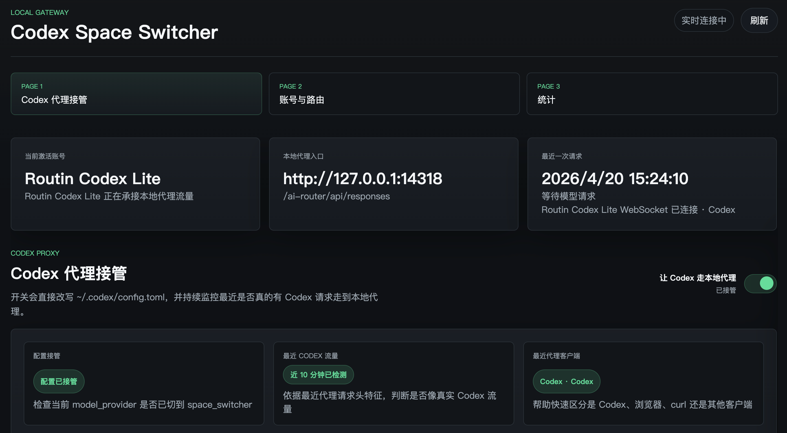

# Codex Space Switcher

一个面向 Codex Desktop 的本地账号路由与用量审计控制台。

`Codex Space Switcher` 不是去劫持或反复切换 Codex Desktop 当前登录态，而是在本机前面放一个薄网关，把“请求由哪个账号承接”“最近是谁在消耗额度”“当前 Codex 是否真的走了本地代理”这些问题收敛到一个明确、可观测的控制面里。



## 项目定位

在重度使用 Codex Desktop 时，真正容易失控的通常不是请求能不能发出去，而是下面这些边界问题：

- 官方账号和第三方 OpenAI-compatible API 混用后，很难确认当前流量到底走了谁
- 账号切换依赖桌面端当前登录态，切换路径脆弱，排查成本高
- 用量信息常常只停留在空间或平台层，难以落到具体账号
- 接入本地代理之后，转发能力有了，但运行状态和审计信息反而更难看清

这个项目的目标很直接：

**用一个本地优先的薄网关，把 Codex 的账号切换、代理接管、额度观察和 usage 审计统一起来。**

## 核心特性

### 本地路由优先，而不是桌面登录态优先

项目当前主路径不是“切换 Codex Desktop 当前账号”，而是“切换本地网关当前激活账号”。

这意味着：

- Codex 请求先进入本地代理
- 本地代理决定当前由哪个账号承接
- 账号切换变成显式的本地路由切换，而不是隐式的桌面端状态切换

这样做的价值在于，切换行为更稳定，故障边界更清晰，也更容易定位到底是代理问题、账号问题，还是桌面端配置问题。

### 官方账号与第三方账号统一管理

项目不是只做官方账号切换，也不是单纯做第三方 API 聚合。

它把两类账号统一抽象成“可被本地网关激活的运行目标”，并在同一个控制台里展示：

- 当前激活状态
- 账号健康状态
- 最近请求情况
- 累计 token
- 累计费用
- 官方账号额度窗口

### 用量统计落到账号维度

所有经过本地代理的请求，都会转成可聚合的本地 usage 事件。

控制台当前支持查看：

- 输入 token
- cache token
- 输出 token
- 估算费用
- 最近请求列表
- 全部 / 官方 / 第三方 / 单账号筛选

这让你看到的不再只是“某个空间快到上限了”，而是“具体哪个账号在消耗资源”。

### 薄网关设计，不做重型平台

这个项目有意保持协议面收敛，不把自己做成一个复杂的中台或通用网关。

当前重点集中在：

- `/responses`
- `/models`
- WebSocket upgrade 透传
- 账号路由
- 本地 usage 审计

这不是能力不足，而是设计选择。边界清晰，反而更适合本地部署和长期维护。

## 功能概览

- 本地控制台：
  - 查看账号状态
  - 查看代理状态
  - 查看最近请求
  - 查看 token 与费用统计
- 本地代理：
  - `POST /ai-router/api/responses`
  - `GET /ai-router/api/models`
  - 兼容 `/ai-router/api/v1/*`
- 官方账号支持：
  - 自动识别当前 `~/.codex/auth.json`
  - 支持维护多个官方账号快照
  - 支持直接粘贴 `https://chatgpt.com/api/auth/session` 返回结果创建账号
- 第三方账号支持：
  - 接入 OpenAI-compatible API
  - 创建时可选 `/models` 可用性校验
- Codex 接管能力：
  - 可直接管理 `~/.codex/config.toml`
  - 展示当前 provider 与受管 provider 配置
  - 检测最近 Codex 流量是否真实经过本地代理
- 本地用量审计：
  - token 统计
  - cache token 统计
  - output token 统计
  - 费用估算
  - 最近请求历史

## 截图

### 账号与代理状态面板


### Token 与费用统计面板


## 工作方式

```text
Codex Desktop
    |
    v
本地薄网关
    |
    +--> 当前激活的官方账号
    |
    +--> 当前激活的第三方账号
    |
    +--> 本地 usage 事件存储
             |
             v
          控制台聚合展示
```

当前实现可以理解为三层：

1. 控制台前端：负责状态展示、账号管理和操作入口
2. 本地薄网关：负责 `/responses`、`/models`、WebSocket upgrade 与账号路由
3. 本地状态与审计存储：负责账号定义、代理状态、Codex 接管状态和 usage 事件持久化

## 快速开始

### 环境要求

- macOS
- Node.js `24+`
- 已安装 Codex Desktop

### 启动

```bash
npm install
npm run dev
```

默认地址：

- 控制台：`http://127.0.0.1:14318`
- 代理入口：`http://127.0.0.1:14318/ai-router/api/responses`
- 模型列表：`http://127.0.0.1:14318/ai-router/api/models`

## 接入 Codex Desktop

如果你希望 Codex Desktop 通过本地代理发请求，可以把 provider 指向本地服务：

```toml
model_provider = "space_switcher"

[model_providers.space_switcher]
name = "space_switcher"
base_url = "http://127.0.0.1:14318/ai-router/api"
wire_api = "responses"
requires_openai_auth = true
```

控制台里也提供了接管入口，可以直接改写 `~/.codex/config.toml`，并展示：

- 当前 `model_provider`
- 当前 provider 的 `base_url`
- 受管 provider 的 `base_url`
- 最近 10 分钟是否检测到 Codex 流量经过本地代理

## 账号配置

默认情况下，服务会自动把当前 `~/.codex/auth.json` 识别成一个官方账号。

如果你要接入多个官方账号或第三方账号，可以通过以下两种方式配置：

- 控制台里的新增账号表单
- `CODEX_SPACE_SWITCHER_HOME/accounts.json`

示例：

```json
{
  "includeCurrentCodexSession": true,
  "accounts": [
    {
      "id": "official-b",
      "name": "官方账号 B",
      "kind": "official",
      "authFile": "/Users/you/.codex-space-switcher/auth/official-b.json"
    },
    {
      "id": "third-party-main",
      "name": "第三方账号",
      "kind": "third_party",
      "apiBaseUrl": "https://api.openai.com/v1",
      "apiKeyEnvName": "SPACE_SWITCHER_THIRD_PARTY_KEY",
      "defaultModel": "gpt-5.4-mini"
    }
  ]
}
```

### 多官方账号接入方式

常见做法有两种：

1. 保存多个 `auth.json` 快照，并在 `accounts.json` 中分别引用
2. 直接把 `https://chatgpt.com/api/auth/session` 的返回结果粘贴到控制台

当前项目只会从粘贴结果中提取本地代理所需字段：

- `accessToken`
- `account.id`
- `user.name`
- `user.email`
- `expires`

这足够支撑路由转发和额度查询；但由于没有 `refresh_token`，会话过期后需要重新粘贴。

## 状态目录

默认状态目录：

- `./.codex-space-switcher-state/`

也可以通过环境变量改写：

```bash
export CODEX_SPACE_SWITCHER_HOME="$HOME/.codex-space-switcher"
```

关键文件包括：

- `accounts.json`
- `auth/*.json`
- `gateway-state.json`
- `usage-events.jsonl`

## 项目结构

```text
codex-space-switcher/
├── apps/
│   ├── backend/
│   │   └── src/
│   ├── frontend/
├── packages/
│   └── shared/
└── docs/
    └── screenshots/
```

## 测试

```bash
npm test
```

当前测试重点覆盖：

- 官方额度接口解析
- `/responses` usage 捕获
- WebSocket usage 捕获
- 费用估算
- 第三方账号校验
- 统计聚合与账号更新流程

## 已知限制

- 当前主路径是“本地代理切换账号”，不是直接控制官方私有空间切换
- 多官方账号仍依赖登录态快照或手动粘贴会话
- 费用为基于模型定价规则的估算值，不等同于官方精确账单
- 第三方账号没有统一额度标准，当前主要关注代理用量审计，不伪造统一余额接口
- 网关刻意保持轻量，不做复杂补偿、多轮编排或通用平台代理层
