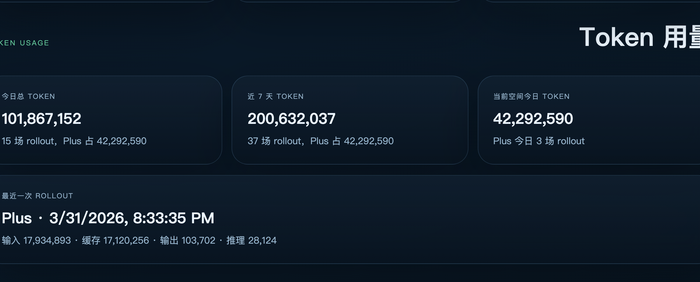
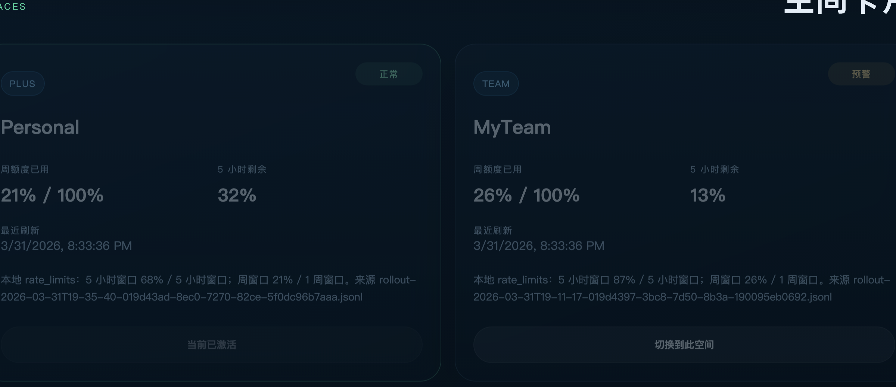

# Codex Space Switcher

`Codex Space Switcher` 是一个只运行在本机 `localhost` 的 Codex Desktop 控制台。  
它会复用当前机器上的 Codex Desktop 登录态，帮你在 `Plus` 和 `Team` 空间之间查看额度、切换空间，并在需要时自动重启 Codex Desktop。

这个项目的设计目标不是做一个公网产品，而是做一个“你自己这台 Mac 上可控、可诊断、可扩展”的本地控制平面。


## 现在能做什么

- 展示当前可见空间卡片，并区分 `Plus` / `Team`
- 显示空间健康状态、当前激活空间、最近一次切换结果
- 显示空间额度语义：
  - `周额度已用`
  - `5 小时剩余`
- 显示 Codex Desktop 运行状态
- 显示 token 用量：
  - 今日 token
  - 近 7 天 token
  - 当前空间今日 token
  - 最近一次 rollout 的输入、缓存、输出、推理 token 明细
- 支持排队切换：
  - 如果 Codex 正在忙，则先排队
  - 空闲后自动执行切换
- 切换后自动关闭并重新拉起 Codex Desktop
- 提供 REST API 与 SSE，方便后续继续扩展

## 界面预览

### 首页


### Token 用量面板



### 空间卡片



## 运行截图对应的核心逻辑

这个项目目前主要依赖三类本地信息源：

1. `~/.codex/auth.json`
   用来读取当前登录态和 `ChatGPT-Account-Id`
2. ChatGPT / Codex 的私有接口
   用来枚举当前账号可见空间、补充空间元数据、尝试执行空间切换
3. `~/.codex/sessions/**/*.jsonl`
   用来读取本地 `token_count` 与 `rate_limits` 事件，补齐“真实 token 消耗”和额度窗口信息

也就是说，页面里很多数字并不是拍脑袋估出来的，而是来自 Codex Desktop 本地已经落盘的事件记录。

## 项目结构

```text
codex-space-switcher/
├── apps/
│   ├── backend/
│   │   └── src/
│   │       ├── server.ts
│   │       ├── space-usage-provider.ts
│   │       ├── space-switch-service.ts
│   │       ├── token-usage-provider.ts
│   │       ├── local-rate-limit-provider.ts
│   │       └── codex-runtime-inspector.ts
│   └── frontend/
│       ├── index.html
│       ├── app.js
│       └── styles.css
├── packages/
│   └── shared/
│       └── src/
│           ├── contracts.ts
│           └── index.ts
├── package.json
└── README.md
```

## 技术方案

### 后端

- 运行环境：`Node.js 24+`
- 形式：单进程本地 HTTP 服务
- 监听地址：`127.0.0.1:4318`
- 能力：
  - 静态资源服务
  - REST API
  - SSE 推送
  - 私有接口调用
  - 本地会话 / 日志 / JSONL 扫描
  - Codex Desktop 重启编排

### 前端

- 原生 HTML / CSS / JavaScript
- 不依赖打包器
- 通过 REST 拉首屏数据
- 通过 SSE 做局部刷新，避免整页抖动

### 数据语义

当前空间卡片里两列指标的含义已经固定：

- `周额度已用`
  来自本地 `rate_limits.secondary`
- `5 小时剩余`
  来自本地 `rate_limits.primary`

token 区块的数据来自本地 `token_count.info.total_token_usage`，必要时会回退到 `last_token_usage`，避免刚开启 rollout 时被统计成全 0。

下图展示了 token 面板的当前表现形式：


## 本地启动

### 环境要求

- macOS
- 已安装并登录 Codex Desktop
- Node.js `24+`

### 启动命令

```bash
cd /Users/cxl/temp/codex-space-switcher
npm run dev
```

或：

```bash
cd /Users/cxl/temp/codex-space-switcher
node --experimental-transform-types apps/backend/src/server.ts
```

启动后访问：

- [http://127.0.0.1:4318](http://127.0.0.1:4318)

## 测试

```bash
cd /Users/cxl/temp/codex-space-switcher
npm test
```

当前测试覆盖了：

- JWT 解析
- 额度窗口解析
- 健康状态映射
- token 聚合逻辑
- 切换队列的基础保护逻辑

## API

### `GET /api/spaces`

返回所有空间卡片。

当前空间卡片会直接展示“周额度已用”和“5 小时剩余”：


### `GET /api/status`

返回当前激活空间、Codex Desktop 运行状态、切换任务状态。

### `GET /api/token-usage`

返回 token 用量总览，包括：

- 今日
- 近 7 天
- 最近一次 rollout

### `POST /api/refresh`

立即刷新空间、运行态和 token 统计。

### `POST /api/switch`

请求切换到某个空间。

请求体：

```json
{
  "targetSpaceId": "your-space-id"
}
```

### `GET /api/events`

SSE 事件流，当前会推送：

- `spaces.updated`
- `codex.status_changed`
- `token_usage.updated`
- `switch.queued`
- `switch.started`
- `switch.restart_started`
- `switch.verified`
- `switch.failed`

## 可配置项

默认状态目录会写到当前项目下的 `.codex-space-switcher-state/`。

如果你想放到别的位置，可以设置：

```bash
export CODEX_SPACE_SWITCHER_HOME="$HOME/.codex-space-switcher"
```

然后再启动服务。

## 手工补充空间

当私有接口字段变化、自动枚举不够稳定时，可以提供：

- `CODEX_SPACE_SWITCHER_HOME/manual-spaces.json`

示例：

```json
{
  "spaces": [
    {
      "id": "acc_plus_xxx",
      "name": "Personal Plus",
      "kind": "plus",
      "switchHints": [
        {
          "method": "POST",
          "path": "/backend-api/accounts/switch",
          "body": {
            "account_id": "acc_plus_xxx"
          }
        }
      ]
    }
  ]
}
```

## 已知限制

- 这是一个本地工具，不适合直接暴露到公网
- 空间切换仍依赖未公开私有接口，接口变化时可能需要重新适配
- `Team` 与 `Plus` 的额度语义目前来自本地 rollout 中的 `rate_limits`，如果 Codex Desktop 后续更改事件格式，需要同步调整解析逻辑
- token 统计目前按 rollout 聚合，不是逐消息精确账单视图
- 自动切换成功率依赖当前桌面登录态、私有接口可用性和本机 Codex Desktop 运行状态

## 安全提醒

这个项目会读取本机 `~/.codex` 下的登录态和会话数据。  
如果你准备把仓库分享给别人，务必不要把下面这些内容提交进 git：

- `.codex-space-switcher-state/`
- `manual-spaces.json`
- 任何带有真实账号、token、cookie、会话内容的临时文件

仓库内已经通过 `.gitignore` 做了基础保护，但本地敏感文件仍然建议你自己再留意一遍。

## 后续可扩展方向

- 增加按天折线图
- 增加 `Plus / Team` token 对比图
- 增加真实切换接口的更强自适应探测
- 增加切换历史与失败原因面板
- 增加“切换后自动恢复上次工作区”能力
